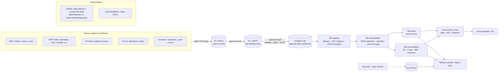
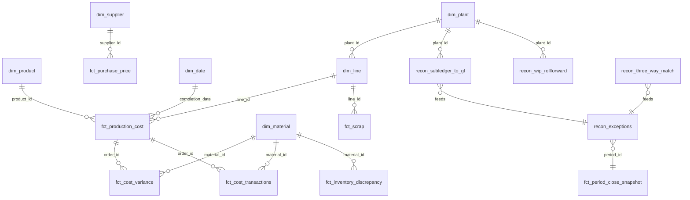

# Manufacturing Cost Intelligence Platform

**Live report:** https://yukthapriya.github.io/manufacturing-cost-intelligence/ is a one-page, plain-English summary of what the pipeline found, with no setup needed.

**Stack:** Python · SQL · PostgreSQL · dbt · Airflow (or Argo Workflows) · Docker · Kubernetes (kind + Kustomize + Helm) · AWS S3 (MinIO locally) · Terraform · Tableau · GitHub Actions

## In short

This pipeline answers the question a manufacturing accounting team works on every month: **what did it really cost to build each unit, and do the books agree with the factory floor?** It takes production, material, labor, scrap, purchasing, inventory and general ledger records and compares what each product *should* have cost with what it *did* cost. It splits the difference into clear causes and checks that the ledger ties to the factory records before a month can be closed.

On a year of data it traced a **$26.6M overrun** mainly to one production line. It also found **every ledger error planted in the data**, named the cause of each, and blocked the month-end close until they were fixed.

## What this project does

It works the way a month-end cost system does. Every unit built generates thousands of cost transactions: parts pulled from inventory, hours booked by operators, scrap, purchases and shipments. The pipeline collects them every day, cleans them, and produces three things:

1. **The true cost of every production order**, compared with its standard cost.
2. **An explanation of every difference**, broken into material price, material usage, scrap, labor rate, labor efficiency and overhead. The six pieces add up exactly to the total, so nothing is left unexplained.
3. **Proof that the numbers tie**, checked before a month is signed off and locked. The ledger, inventory, work in progress and purchase documents are each checked against the factory records.

## The data

The data is **synthetic**. Real manufacturing cost data is confidential, so I generated a realistic dataset modeled on how an ERP, a manufacturing execution system (MES) and an accounts-payable system record transactions.

| Dataset | Volume (one year) | What it represents |
|---|---|---|
| Plants, lines, products, materials, suppliers | 3 plants, 6 lines, 40 products, 300 materials, 25 suppliers | Master data |
| Bill of materials | Multi-level, with scrap allowances | What each product should consume |
| Standard costs | Effective-dated versions | Planned material prices, labor and overhead rates, labor hours |
| Production orders | ~9,000 | Planned vs. completed quantities |
| Material issues | ~190,000 | Parts pulled from inventory into production |
| Labor entries | ~33,000 | Operator time bookings, including overtime and late postings |
| Scrap records | ~38,000 | Material scrapped, with reason codes |
| Purchase orders, goods receipts, supplier invoices | ~12,000 each | The purchasing trail |
| Inventory snapshots and cycle counts | Monthly | System stock vs. physical counts |
| General ledger | Daily journal entries | Inventory, work in progress, finished goods, COGS and variance accounts |

The data is deliberately messy, the way real data is: duplicate supplier invoices, quantities entered in grams instead of kilograms, invoices without PO numbers, labor posted weeks late, and negative inventory. Four ledger errors are also planted: a missing posting, a duplicate posting, cost booked to the wrong plant, and a month-end cutoff problem. The pipeline has to find them on its own, and an answer key checks that it did.

## The problems it solves

- **Why did it cost more than planned?** It found one production line using 5.9% more material than the bill of materials allows, every month of the year, which accounts for most of the overrun. It also caught a supplier who raised prices about 21% in July, and a two-month scrap spike on another line that traced to machine faults.
- **Can the numbers be trusted enough to close the month?** It compares the ledger with the factory records day by day, tags each difference with its cause, and refuses to sign off a month until the books agree. It then drafts the correcting entries for an accountant to review.
- **Are we paying for the right things?** It matches every purchase order to its receipt and invoice, and flags duplicate invoices, goods billed but never received, and price differences.
- **Where is the inventory going?** It compares system stock with physical counts and shows the shrink by plant.

## How it's built

Python and SQL for the processing, PostgreSQL as the warehouse, and dbt for the cost models. There are over a hundred automated data checks, plus unit tests that verify the variance math against hand calculations. Airflow schedules the daily load and the month-end close, with each step running in its own container on Kubernetes. The details are below.

---

## Architecture



Each step is a CLI entry point packaged in its own image (`mci-generator`, `mci-loader`,
`mci-dbt`, `mci-exporter`). Airflow runs them as local processes (Docker Compose) or as
isolated pods (`EXECUTION_MODE=k8s`). Argo runs the same images. See `docs/interfaces.md`.

## What it does, layer by layer

| Layer | Highlights |
|---|---|
| **Generator** (`data_generator/`) | 12 months, 3 plants, 6 lines, 40 products, 300 materials, multi-level BOM. Deliberately messy: duplicate supplier invoices, gram/kilogram mix-ups, invoices without PO references, late labor postings, negative ERP stock, a supplier price surcharge, a line with chronic overuse, a scrap spike, junk rows, and four GL breaks. `--scale` is linear in volume. An answer key records everything that was injected. |
| **Ingestion** (`ingestion/`) | Storage abstraction (S3/MinIO or local). Vectorised schema validation; bad rows go to `raw.rejects` with a reason. Idempotent loads (SHA-256 per file; delete+COPY in one transaction). Monthly range partitions on the large raw tables. |
| **Staging** | De-duplication across reloads, CDC event collapse for orders, UOM normalisation, duplicate-invoice detection (flagged, not deleted). |
| **Intermediate** | Recursive BOM explosion, versioned standards joined by effective date, per-transaction valuation rounded like an ERP, the period-lock routing rule for late postings, actual purchase price (weighted, carried forward), WIP activity and period-end settlement. |
| **Marts** | `fct_cost_variance` (order × element × material, with source transaction IDs), `fct_production_cost`, `fct_unit_cost`, `fct_scrap`, `fct_inventory_discrepancy`, `fct_purchase_price`, `fct_cost_transactions` (drill-through), and dimensions. |
| **Reconciliation** | Subledger-to-GL at day and period grain with root-cause tagging, inventory balances with an independent valuation, WIP roll-forward, three-way match with auto-matching of unreferenced invoices, and a unified exception queue. |
| **Quality** | 104 dbt data tests (keys, relationships, accepted values, custom generic tests, singular reconciliation tests) plus 4 dbt unit tests with hand-calculated cases. Layer row-count and freshness checks. Results published to `dq.*`. |
| **Close** (`close/`) | Sign-off gate (prior period closed, no material GL breaks, WIP ties, dbt green). Period lock with an immutability trigger on final snapshots. Close package workbook. Correcting-entry proposals. |
| **Orchestration** | Airflow DAGs (daily pipeline, business-day-1 close with a data-completeness sensor), Argo WorkflowTemplates + CronWorkflow, retries/backoff, SLA and failure alerts (Slack webhook stub). |
| **Platform** | Multi-stage non-root Dockerfiles, Docker Compose, kind + Kustomize (dev/prod overlays) + the official Airflow Helm chart, Terraform for S3/IAM/RDS, and GitHub Actions CI. |

The full cost-accounting design (journal flows, variance formulas, period lock and
reconciliation logic) is in **[docs/cost_model.md](docs/cost_model.md)**.

## Variance formulas

| Element | Formula |
|---|---|
| Material price | (AP − SP) × AQ |
| Material usage | (AQ − AS − SQgood) × SP |
| Scrap | (AS − SQallowed) × SP |
| Labor rate | actual labor cost − SR × AH |
| Labor efficiency | (AH − SH) × SR |
| Overhead efficiency | overhead applied − OHR × SH |

The six elements sum **exactly** to actual cost − standard cost for every completed order.
This is enforced by a singular dbt test and covered by hand-calculated dbt unit tests.

## Quickstart

### Option A: Docker Compose (Postgres, MinIO, Airflow)
```bash
make up          # Airflow UI http://localhost:8080 (admin/admin), MinIO console http://localhost:9001
make seed        # generate one year of source data into the MinIO source bucket
make run         # land -> load -> dbt build + tests -> checks -> close -> close packages -> Tableau extracts
```
Or run it the Airflow way: unpause `manufacturing_cost_pipeline`. It backfills daily from
Dec 2024 and `month_end_close` acts on business day 1.

### Option B: your own Postgres, no Docker
```bash
pip install -r requirements.txt -r requirements-dbt.txt -r requirements-dev.txt
export WAREHOUSE_HOST=localhost WAREHOUSE_USER=postgres WAREHOUSE_DB=mfg_cost \
       SOURCE_URI=./data/source_drop RAW_URI=./data/raw
createdb mfg_cost
python -m data_generator.generate --start 2025-01-01 --months 12 --scale 1
bash scripts/run_pipeline.sh
pytest                       # unit + integration tests
```

### Option C: Kubernetes (kind)
```bash
make k8s-up                                  # builds images, kind cluster, Kustomize dev overlay, Airflow via Helm
kubectl -n mci apply -f k8s/jobs/seed-job.yaml
# Airflow UI http://localhost:30080 - every task runs as its own pod (KubernetesPodOperator)
kubectl apply -f argo/                       # optional: the same pipeline as Argo WorkflowTemplates
```

### Dashboards
`make extracts` writes `tableau/extracts/mci.hyper` (plus CSVs). Build the five dashboards
from **[tableau/dashboard_spec.md](tableau/dashboard_spec.md)**: Unit Cost, Manufacturing Variance,
Scrap & Yield, Inventory + Data Quality, and Close Readiness, each with drill-through to transactions.
For a quick look without Tableau, run `pip install -r requirements-app.txt && streamlit run app/streamlit_app.py`.

## Data model


Source extracts are documented in [docs/data_dictionary.md](docs/data_dictionary.md).

## Results on the default dataset (scale 1, seed 42)

**What the pipeline found, as the dataset was designed to contain:**

| Finding | Where it shows up |
|---|---|
| Total variance **+$26.6M (1.88%)** on $1.415B standard | `fct_production_cost` |
| **FRE1-L2 chronic overuse**: $16.5M usage variance, 5.9% over standard, unfavorable 12 months in a row | `sql/03_chronic_material_overuse.sql`, variance heatmap |
| **Supplier S007 surcharge**: price index jumps from ~101 to 121 vs. standard in July | `sql/02_supplier_price_trend_vs_standard.sql` |
| **RNO1-L1 scrap spike**: scrap rate 6.0% in Apr–May vs. ~1.9% normally, mostly `MACHINE_FAULT` | `fct_scrap`, `sql/04_scrap_rate_by_reason.sql` |
| **All four injected GL breaks detected with the correct root cause**: missing posting (FRE1, Mar, $2.81M), duplicate posting (AUS1, May, $0.56M), misposted plant (Aug, $11.7K), timing cutoff (RNO1, Oct→Nov, $1.70M). Zero unexplained breaks. | `recon_gl_daily`, `recon_subledger_to_gl` |
| Everything else in the subledger **ties to the GL to the cent**, including late-labor routing, UOM conversion and settlement | `recon_gl_daily` has no other rows |
| WIP roll-forward **ties for all 39 plant-periods** | `recon_wip_rollforward` |
| Three-way match: 8,632 matched, 2,263 within tolerance, 1,181 exceptions, including 205 receipts auto-matched to invoices that arrived without a PO reference | `recon_three_way_match` |
| 176 duplicate invoices, 1,165 gram-booked issues and 111 junk rows rejected, each matching the generator's answer key; 474 late labor entries routed to the open period | integration tests, `int_labor_entries` |

**Close:** Jan and Feb sign off. **March is blocked** by the missing GL posting, and later
periods wait for March because close runs in order. Running
`python -m close.propose_corrections --period 2025-03 --post` (then the same for 05, 08 and 10)
drops balanced correcting entries into the landing zone. After the next load and dbt build,
**all 12 periods sign off**. The one amount the reconciliation cannot see (the GRNI side of the
duplicated receipt) is parked in suspense account 1999 for review.

## Verification

| Check | Result |
|---|---|
| dbt build | 170 nodes: **163 pass, 7 warn, 0 fail**. The warnings are the injected source problems, tracked on purpose. |
| dbt unit tests (variance math, settlement with late labor, root-cause tagging) | 4/4 pass |
| pytest | 31 unit + 6 integration tests pass, on pandas 3 / numpy 2 and on pandas 2.1.4 / numpy 1.26 (the Airflow 2.10.5 constraint set) |
| Incremental vs. full refresh (`scripts/check_incremental.sh`) | Identical row-for-row across all 5 incremental models after a split load with late-arriving data |
| Airflow DAGs | Both DAGs load with zero import errors in Airflow 2.10.5, in `local` and `k8s` modes |
| Kubernetes manifests | `kustomize build` dev/prod plus kubeconform (strict); Argo templates validated; Helm values validated against the chart 1.15.0 schema |
| Dockerfiles / CI | hadolint and actionlint clean; `docker compose config` valid |
| End-to-end runtime (scale 1, 2-vCPU sandbox) | generate 10s, full pipeline (load → dbt → close → extracts) **2m32s** |

Not exercised in the build sandbox: building the images, running the kind cluster, and
`terraform plan`. The CI `docker-build` job is the first real image build.

## Benchmarks

| scale | material issue lines | variance rows | load | dbt build + 170 tests | incremental re-run |
|---|---|---|---|---|---|
| 1 | 190K | 0.6M | 90s | 25s | n/a |
| 10 | 1.9M | 5.9M | 140s | 124s | 16s |
| 30 | **5.7M** | **17.8M** | 192s | 394s | 29s |

Measured on a 2-vCPU sandbox with zero failing tests at every scale; details are in
[benchmarks/results.md](benchmarks/results.md). `make bench SCALE=50` gives ~10M issue lines
(about 25–30 minutes and 20 GB of disk on similar hardware). Scale-up techniques: monthly range
partitions on raw, incremental models (delete+insert on business keys with a `_loaded_at`
watermark and late-arrival lookback), recompute of only the changed orders, and targeted indexes.

## Repository map

```
data_generator/   synthetic sources + answer key          ingestion/   land, validate, load (S3/local)
dbt/              staging → intermediate → marts → recon  quality/     layer checks, DQ publish, alerts
close/            sign-off gate, lock, corrections        exporter/    Tableau extracts, close package
airflow/dags/     daily pipeline, month-end close         argo/        same pipeline on Argo
docker/ k8s/      images, compose, kind/Kustomize/Helm    infra/terraform/  S3, IAM (IRSA), RDS
sql/              six analysis queries                    tableau/     dashboard spec (+ extracts)
app/              Streamlit preview                       docs/        cost model, runbook, data dictionary
```

Operations are covered in **[docs/runbook.md](docs/runbook.md)**: rerunning a failed day,
backfilling a period, investigating a reconciliation break, and a WIP roll-forward that won't tie.

## Summary of what was built

- Built containerized ETL/ELT pipelines (Python, SQL, dbt, PostgreSQL) orchestrated with Airflow on Kubernetes (KubernetesPodOperator, kind, Helm) and Argo Workflows, ingesting and reconciling production, BOM, supplier invoice, inventory, labor and scrap records from S3 into a unified manufacturing cost model.
- Developed standard-vs-actual variance analysis separating material price, usage, scrap, labor rate/efficiency and overhead impacts, with every element tying exactly to total cost and traceable to source transactions. It surfaced a production line running 5.9% over standard for 12 consecutive months.
- Automated subledger-to-GL, three-way match, inventory and WIP roll-forward reconciliations with root-cause tagging, and a month-end close workflow that locks periods, blocks sign-off on material breaks and generates close packages. It detected 100% of seeded GL breaks with zero unexplained differences.
- Implemented data quality across 104 dbt data tests, hand-calculated dbt unit tests, layer row-count and freshness checks, idempotent checksum-based loads and incremental models proven equivalent to full refresh, delivered through Tableau dashboards and CI on GitHub Actions.